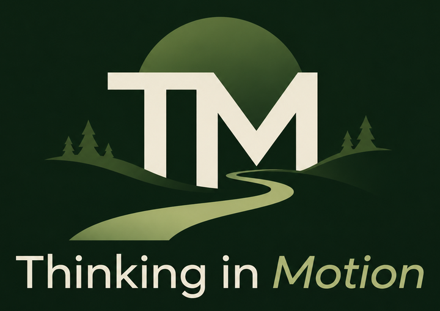

I'm Brett Earle, a software engineer with a passion for building things, solving problems, and understanding how the world works.

My background spans software engineering, technical leadership, and a few less conventional paths along the way. I've always been drawn to figuring out how things work, questioning why we do things a certain way, and finding better ways forward.

I'm particularly interested in the intersection of **technology, productivity, and philosophy**. How we think, how we work, and how we adapt to a world that's changing faster than ever.

I enjoy exploring ideas, challenging assumptions, and turning what I learn into something practical. Whether that's building better software, improving how I work, or borrowing ideas from philosophy to make better decisions.

## Thinking in Motion

Thinking in Motion is my space to write about those interests.

It's part learning journal, part exploration of ideas, and part reflection on the changing world around us.

I'm not here to pretend I have all the answers. I'm here to think out loud, share what I'm learning, and hopefully spark a few worthwhile conversations.

**Think clearly. Move deliberately.**
